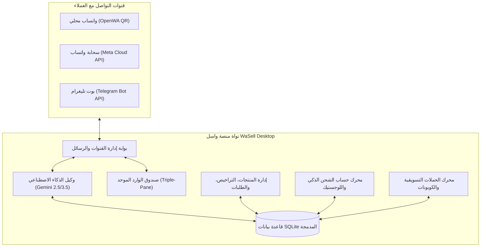

# وثيقة النسخة المستقرة — منصة واسل WaSell v1.0.0 (Stable Release)

> **الإصدار:** `v1.0.0-stable`  
> **تاريخ الاعتماد:** 07 نوفمبر 2026  
> **حالة الإصدار:** 🟢 جاهز للإنتاج (Production Ready)  
> **الترخيص:** تجاري / ملكية خاصة لمنصة WaSell  
> **المستودع الرئيسي:** `ammarnaass/whatsapp-store-bot-marketing`

---

## 📌 الفهرس العام
1. [نظرة عامة على النظام](#1-نظرة-عامة-على-النظام)
2. [المميزات الرئيسية المعتمدة](#2-المميزات-الرئيسية-المعتمدة)
3. [معمارية النظام والتقنيات (Architecture & Tech Stack)](#3-معمارية-النظام-والتقنيات)
4. [مخطط قاعدة البيانات (Database Schema Overview)](#4-مخطط-قاعدة-البيانات)
5. [متطلبات التشغيل والبيئة (System Requirements)](#5-متطلبات-التشغيل-والبيئة)
6. [دليل التثبيت والتشغيل السريع (Installation & Quick Start)](#6-دليل-التثبيت-والتشغيل-السريع)
7. [أوامر البناء والتوزيع (Packaging & Distribution)](#7-أوامر-البناء-والتوزيع)
8. [معايير الجودة وفحوصات الأمان (QA & Verification)](#8-معايير-الجودة-وفحوصات-الأمان)
9. [سجل التغييرات الشامل (Changelog v1.0.0)](#9-سجل-التغييرات-الشامل)

---

## 1. نظرة عامة على النظام

منصة **واسل (WaSell)** هي تطبيق مكتبي احترافي متكامل مبني على إطار عمل Electron و React 19 و TypeScript، مصمم خصيصاً لإدارة المتاجر الإلكترونية، وأتمتة مبيعات المحادثات عبر **واتساب (WhatsApp)** و**تليغرام (Telegram)** باستخدام **وكيل الذكاء الاصطناعي (AI Sales & Support Agent)** فائق الذكاء، مع نظام تسويق ذكي يحمي من الحظر، ونظام شحن دولي وهرمي متقدم، وقسم مخصص لبيع حلول البرمجيات وتراخيص التفعيل الرقمية.



---

## 2. المميزات الرئيسية المعتمدة

### 2.1. محرك الربط المزدوج لواتساب (Dual WhatsApp Engine)
- **بوابة OpenWA المحلية:** ربط فوري عبر مسح رمز QR محلياً بدون تكلفة أو وسيط خارجي، مع استقرار الجلسات وإعادة الاتصال التلقائي.
- **بوابة Meta WhatsApp Cloud API:** الربط السحابي المباشر عبر الواجهة الرسمية لشركة Meta للأعمال التجارية الكبيرة والمؤسسات، مع دعم رسائل القوالب المعتمدة (HSM Templates) والبث اللحظي للـ Webhooks.

### 2.2. بوابة بوت تليغرام (Telegram Bot Gateway)
- تشغيل البوت وإدارته برمز التوكن (Bot Token) مع فحص سلامة الاتصال اللحظي.
- عرض كتالوج المنتجات تفاعلياً للمستخدمين فور الضغط على `/start` أو `/catalog`.
- رد آلي ذكي عبر وكيل الذكاء الاصطناعي على كافة استفسارات العملاء في تليغرام بالتوازي مع واتساب.

### 2.3. وكيل الذكاء الاصطناعي للمبيعات والدعم (AI Sales & Support Agent)
- مدعوم بأحدث نماذج Google Gemini (Gemini 2.5/3.5 Flash Lite) لتحقيق استجابة فائقة السرعة (< 800ms) وتكلفة منخفضة جداً.
- **استدعاء دوال حية (Function Calling):**
  - `search_catalog`: البحث الذكي في المنتجات والأسعار والتفاصيل.
  - `get_product`: عرض مواصفات وصور المنتج وروابط الطلب.
  - `get_shipping_quote`: حساب دقيق لتكاليف الشحن حسب الدولة والولاية/المحافظة والمدينة وخيار التوصيل للمنزل أو المكتب (Stop Desk).
  - `validate_coupon`: فحص وتطبيق كوبونات الخصم فورياً للعميل.
  - `handover_to_human`: تحويل آمن وفوري للموظف البشري عند الحاجة أو عند طلب العميل.
- محاكاة السلوك البشري الطبيعي أثناء المحادثة مع الكتابة الحية (`SIMULATE_TYPING`) وفواصل التأخير لمنع تصنيف الرقم كحساب روبوتي.

### 2.4. مركز بيع البرمجيات والتراخيص الرقمية (Software Solutions & Licenses Hub)
- قسم مخصص لإدارة المنتجات الرقمية والتطبيقات المكتبية والسحابية (مثل برنامج نقاط البيع POS Pro، برنامج إدارة الروضات RawdaCare، برامج المحاسبة والمطاعم).
- إدارة تراخيص التفعيل: توليد وحفظ مفاتيح التفعيل الموثقة، تحديد نوع الاشتراك (شهري، سنوي، مدى الحياة)، وتحديد عدد الأجهزة المسموحة.
- تتبع حالة التفعيل (نشط، مستخدم، متاح، منتهي) مع روابط الشرح التجريبية (Demo URLs) وبيانات الدعم الفني الخاصة بكل حل برمجي.

### 2.5. نظام الشحن واللوجستيك الدولي والهرمي (Global Hierarchical Shipping)
- **دعم كافة دول العالم:** دليل جغرافي عالمي يشمل الجزائر، السعودية، الإمارات، مصر، المغرب، تونس، الأردن، الكويت، سائر الدول العربية والعالم.
- **دليل تفصيلي للولايات والمحافظات:**
  - ولايات الجزائر الـ 58 كاملة مع تصنيف مناطقي (الوسط، الشرق، الغرب، الجنوب، الجنوب الكبير).
  - مناطق ومحافظات المملكة العربية السعودية الـ 13.
  - محافظات الإمارات، مصر، وتونس.
- **أنماط التسليم المزدوجة (Dual Delivery Modes):**
  - توصيل مباشر للمنزل (Home Delivery / À Domicile).
  - استلام من المكتب / نقطة التجميع (Stop Desk / Point Relais) بأسعار تنافسية مخفضة.
- **إدارة شركات الشحن (Carriers):** دعم تخصيص شركات الشحن (سمسا، أرامكس، ياليدين، بروكوليس، زاد إكسبريس، البريد، DHL، وأسطول المتجر الخاص) وتحديد رسوم الدفع عند الاستلام والشحن المجاني.
- **بوالص الشحن والتتبع:** إصدار أرقام التتبع، وإرسال إشعار فوري للعميل برابط التتبع عبر واتساب بضغطة زر.

### 2.6. صندوق الوارد الموحد (Triple-Pane Unified Inbox)
- شاشة موحدة مقسمة إلى ثلاثة أجزاء متناسقة: قائمة المحادثات والحالات ⬅️ نافذة الشات المباشرة ⬅️ بطاقة بيانات العميل ومشترياته وملاحظات الـ CRM وسلة الطلب الفورية.

### 2.7. نظام التسويق والكوبونات (Marketing Campaigns & Coupons)
- إطلاق حملات رسائل تسويقية جماعية مع نظام فواصل تأخير ديناميكي ذكي (`Anti-Ban Pacing`) وتحديد سقف الإرسال اليومي لتفادي حظر الأرقام.
- إدارة كوبونات الخصم بنوعيها (نسبة مئوية أو مبلغ ثابت) مع شروط الحد الأدنى لقيمة الطلب وتاريخ انتهاء الصلاحية.

---

## 3. معمارية النظام والتقنيات

| الطبقة | التقنية / المكتبة | الغرض والدور |
|:---|:---|:---|
| **بيئة التشغيل** | Electron v35 | تشغيل التطبيق المكتبي المستقل عبر المنصات |
| **واجهة المستخدم** | React v19 + TypeScript | واجهة مستخدم تفاعلية عالية الأداء وسريعة الاستجابة |
| **محرك التنسيق** | Tailwind CSS v4 | نظام تصميم واسل الحديث (WaSell Master Design System) |
| **قاعدة البيانات** | Better-SQLite3 v13 | قاعدة بيانات علائقية محلية فائقة السرعة معزولة بالكامل |
| **محرك الذكاء الاصطناعي** | @google/genai SDK | التكامل مع نماذج Gemini عبر الاستدعاء المباشر للدوال |
| **بوابة واتساب المحلية** | OpenWA (Baileys Engine) | اتصال واتساب مباشر عبر رمز الاستجابة السريعة |
| **بوابة واتساب السحابية** | Fastify + Fetch API | استقبال وإرسال الرسائل عبر Meta Cloud API الرسمية |
| **بوابة تليغرام** | Telegram Bot Polling API | معالجة فورية وتفاعلية لرسائل وتحديثات تليغرام |
| **الأيقونات** | Lucide React | مكتبة أيقونات متناسقة واحترافية |

---

## 4. مخطط قاعدة البيانات

تحتوي قاعدة البيانات المحلية `whatsapp_store.db` على الجداول الأساسية التالية:

```sql
-- 1. مناطق الشحن الدولية والهرمية
CREATE TABLE shipping_zones (
    id TEXT PRIMARY KEY,
    name TEXT NOT NULL,
    country_code TEXT NOT NULL DEFAULT 'SA',
    country_name TEXT NOT NULL DEFAULT 'المملكة العربية السعودية',
    scope_type TEXT NOT NULL DEFAULT 'all_states', -- 'all_states' | 'specific_states' | 'specific_cities'
    states_json TEXT NOT NULL DEFAULT '[]',
    cities_json TEXT NOT NULL DEFAULT '[]',
    fee REAL NOT NULL DEFAULT 0.0,
    free_over REAL,
    is_active INTEGER NOT NULL DEFAULT 1,
    created_at DATETIME DEFAULT CURRENT_TIMESTAMP
);

-- 2. شركات وطرق الشحن وتسعيرات المنزل والمكتب
CREATE TABLE shipping_methods (
    id TEXT PRIMARY KEY,
    zone_id TEXT NOT NULL REFERENCES shipping_zones(id) ON DELETE CASCADE,
    name TEXT NOT NULL,
    carrier_code TEXT DEFAULT 'custom',
    cost REAL NOT NULL DEFAULT 0.0,
    desk_cost REAL,
    delivery_type TEXT NOT NULL DEFAULT 'both', -- 'home' | 'desk' | 'both'
    currency TEXT NOT NULL DEFAULT 'SAR',
    free_over REAL,
    estimated_delivery TEXT,
    cod_available INTEGER DEFAULT 1,
    cod_fee REAL DEFAULT 0.0,
    tracking_url_template TEXT,
    is_active INTEGER NOT NULL DEFAULT 1,
    created_at DATETIME DEFAULT CURRENT_TIMESTAMP
);

-- 3. بوالص الشحن والتتبع اللوجستي
CREATE TABLE shipments (
    id TEXT PRIMARY KEY,
    order_id TEXT NOT NULL,
    carrier TEXT NOT NULL,
    tracking_no TEXT NOT NULL,
    tracking_url TEXT,
    status TEXT NOT NULL DEFAULT 'PREPARING',
    customer_phone TEXT,
    address_json TEXT,
    shipped_at DATETIME,
    delivered_at DATETIME,
    created_at DATETIME DEFAULT CURRENT_TIMESTAMP
);

-- 4. حلول البرمجيات ومنتجات التفعيل
CREATE TABLE software_items (
    id TEXT PRIMARY KEY,
    product_id TEXT REFERENCES products(id) ON DELETE CASCADE,
    name TEXT NOT NULL,
    version TEXT NOT NULL DEFAULT '1.0.0',
    platform TEXT NOT NULL DEFAULT 'WINDOWS',
    website_url TEXT,
    demo_url TEXT,
    support_contact TEXT,
    is_active INTEGER DEFAULT 1,
    created_at DATETIME DEFAULT CURRENT_TIMESTAMP,
    updated_at DATETIME DEFAULT CURRENT_TIMESTAMP
);

-- 5. مفاتيح وتراخيص تفعيل البرمجيات
CREATE TABLE software_licenses (
    id TEXT PRIMARY KEY,
    software_id TEXT NOT NULL REFERENCES software_items(id) ON DELETE CASCADE,
    license_key TEXT NOT NULL,
    license_type TEXT NOT NULL DEFAULT 'LIFETIME',
    allowed_devices INTEGER NOT NULL DEFAULT 1,
    price REAL NOT NULL DEFAULT 0.0,
    currency TEXT NOT NULL DEFAULT 'SAR',
    status TEXT NOT NULL DEFAULT 'AVAILABLE',
    assigned_to_order_id TEXT REFERENCES orders(id),
    created_at DATETIME DEFAULT CURRENT_TIMESTAMP
);

-- 6. إعدادات بوت تليغرام
CREATE TABLE telegram_config (
    id TEXT PRIMARY KEY,
    bot_token TEXT,
    bot_username TEXT,
    auto_reply INTEGER DEFAULT 1,
    welcome_message TEXT,
    show_catalog INTEGER DEFAULT 1,
    catalog_limit INTEGER DEFAULT 8,
    catalog_category_filter TEXT DEFAULT 'all',
    show_quick_buttons INTEGER DEFAULT 1,
    is_active INTEGER DEFAULT 0
);
```

---

## 5. متطلبات التشغيل والبيئة

### بيئة تشغيل المستخدم النهائي (Desktop Client)
- **Windows:** نظام Windows 10 أو Windows 11 بمعمارية 64-بت.
- **Linux:** توزيعات Ubuntu 20.04+, Debian 11+, Fedora 36+ (متوفر كـ AppImage أو Deb).
- **الذاكرة العشوائية (RAM):** 4 جيجابايت كحد أدنى (يوصى بـ 8 جيجابايت).
- **المساحة التخزينية:** 500 ميجابايت مساحة فارغة للقرص.

### بيئة التطوير والبناء (Developer Environment)
- **Node.js:** الإصدار 20.x أو 22.x LTS.
- **مدير الحزم:** npm v10+ أو pnpm.
- **أدوات البناء المحلية:** Python 3 و C++ build tools (لتجميع `better-sqlite3`).

---

## 6. دليل التثبيت والتشغيل السريع

```bash
# 1. استنساخ المشروع
git clone https://github.com/ammarnaass/whatsapp-store-bot-marketing.git
cd whatsapp-store-bot-marketing

# 2. تثبيت الاعتماديات
npm install

# 3. بناء واجهات التطبيق ومحرك Electron
npm run build

# 4. تشغيل التطبيق في وضع سطح المكتب
npm start
```

---

## 7. أوامر البناء والتوزيع

| الأمر | الوظيفة | المخرجات |
|:---|:---|:---|
| `npm run build` | بناء كامل للواجهة والـ Main process | `dist/renderer` و `dist/main` |
| `npm run package:dir` | حزم التطبيق في مجلد تنفيذي محلي سريع | `dist_electron/win-unpacked` أو `linux-unpacked` |
| `npm run dist:win` | إنشاء مثبت Windows (NSIS Installer + Portable) | ملف `.exe` قابل للتثبيت |
| `npm run dist:linux` | إنشاء حزم لينكس (AppImage + Debian Package) | ملفات `.AppImage` و `.deb` |
| `npm run dist` | بناء شامل لكافة المنصات المدعومة | حزم التثبيت الكاملة في `dist_electron` |

---

## 8. معايير الجودة وفحوصات الأمان

1. **معيار تجزئة الكود الصارم (`< 120 lines/file`):**
   - تم الالتزام الصارم بتجزئة كافة ملفات الكود البرمجي (Main, Preload, Shared, Components, Services) بحيث لا يتجاوز أي ملف 120 سطراً، مما يضمن أعلى درجات الصيانة وقابلية القراءة.
2. **عزل بيئة التشغيل (Electron Security):**
   - تفعيل `contextIsolation: true`.
   - تعطيل `nodeIntegration: false`.
   - تأمين قنوات IPC عبر طبقة عقود كتابية آمنة (`contracts.ts` و `IPC_CHANNELS`).
3. **أمان البيانات وحماية ضد العبث:**
   - تخزين محلي كامل في SQLite دون إرسال بيانات المتجر أو العملاء لأي خوادم خارجية سوى خوادم الذكاء الاصطناعي الرسمية بمفاتيح التاجر نفسه.
   - حماية استعلامات قاعدة البيانات ضد هجمات SQL Injection باستخدام `Prepared Statements`.

---

## 9. سجل التغييرات الشامل (Changelog v1.0.0)

### 🌟 الإصدار v1.0.0 المستقر (07 نوفمبر 2026)
- **[الشحن واللوجستيك]** إطلاق نظام الشحن الهرمي المتكامل الداعم لـ 58 ولاية جزائرية و 13 منطقة سعودية وكافة دول العالم مع تسعيرات التوصيل المنزلي والمكتبي (Stop Desk).
- **[البرمجيات الرقمية]** تدشين مركز حلول البرمجيات وتراخيص التفعيل الرقمية مع التوليد والتسليم الفوري.
- **[قنوات التواصل]** إضافة بوابة تليغرام بوت المستقلة وربطها بالكتالوج والذكاء الاصطناعي مع أزرار تفاعلية.
- **[الذكاء الاصطناعي]** ترقية محرك الرد الذكي إلى Gemini Flash Lite وتزويده بأداة الحساب الآلي لتكاليف الشحن.
- **[التسويق]** استقرار محرك الحملات التسويقية مع نظام الحماية ضد الحظر ونظام الكوبونات متعدد العملات.
- **[التصميم]** مواءمة شاملة للواجهة وفق نظام WaSell Design System الداعم للوضعين الداكن والفاتح بالكامل.

---
**تم إعداد واعتماد هذه الوثيقة كمرجع رسمي للنسخة المستقرة من تطبيق واسل WaSell.**
