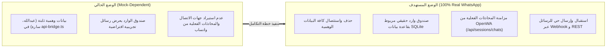
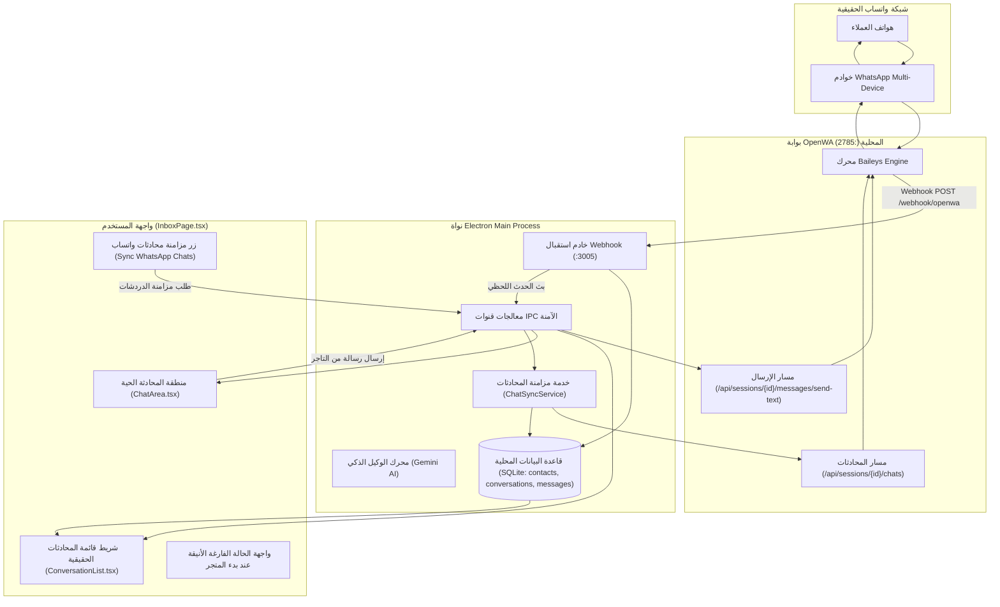
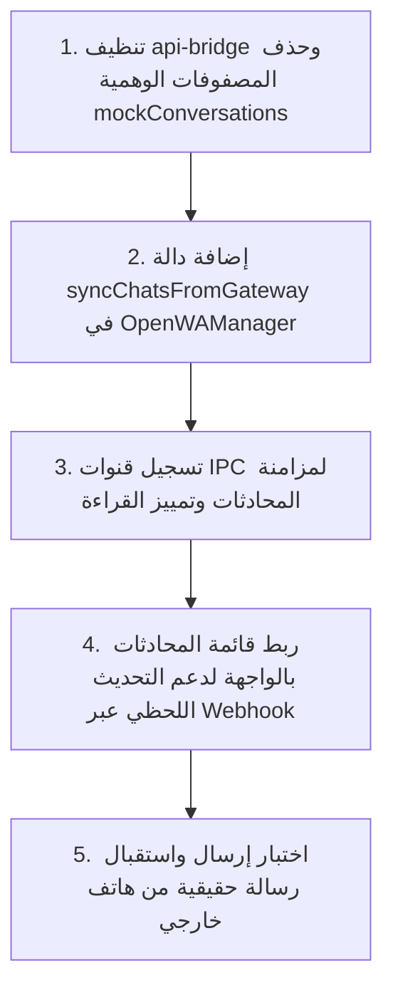

# خطة العمل: حذف البيانات الوهمية في المحادثات وربط صندوق الوارد ببوابة الواتساب الحقيقية
## Real WhatsApp Chat Inbox & Mock Data Purge Plan

> **الهدف الاستراتيجي:** استئصال كافة المحادثات والرسائل الوهمية (Mock Data) من واجهة صندوق الوارد (`InboxPage.tsx`) وقاعدة البيانات، وربط نظام المحادثات كلياً ببوابة OpenWA الحقيقية (:2785) لاستيراد الدردشات، استقبال الرسائل الواردة فورياً، وإرسال الردود الحقيقية للعملاء.

---

## 1. ملخص المشكلة والوضع الراهن (Current State vs Target State)

---

## 2. المعمارية التقنية لتدفق المحادثات الحقيقية (End-to-End Architecture)

---

## 3. محاور خطة العمل التنفيذية (Implementation Pillars)

### المحور الأول: حذف واستئصال البيانات الوهمية (Mock Data Purge)
1. **تنظيف جسر البيانات `api-bridge.ts`:**
   - تفريغ مصفوفات المحادثات الوهمية (`mockConversations = []`).
   - تفريغ سجل الرسائل الوهمية (`mockMessages = {}`).
   - إزالة أي جهات اتصال افتراضية غير حقيقية لضمان عدم ظهور محادثات مزيفة في أي شاشة.
2. **تصميم واجهة الحالة الفارغة الاحترافية (Clean Empty State):**
   - عندما لا توجد محادثات مسجلة بعد في قاعدة البيانات، تظهر بطاقة إرشادية أنيقة:
     > *"صندوق الوارد فارغ وجاهز • بمجرد وصول أول رسالة من عميل عبر واتساب ستظهر المحادثة هنا فورياً، أو انقر على 'مزامنة المحادثات' لجلب محادثاتك السابقة."*
3. **أداة إفراغ البيانات التجريبية (Purge Tool):**
   - توفير خيار برمجي في قاعدة البيانات لتنظيف أي رسائل أو محادثات تجريبية سابقة بضغطة زر دون المساس بإعدادات المتجر أو المنتجات.

---

### المحور الثاني: تطوير خدمة مزامنة محادثات واتساب الحقيقية (WhatsApp Chat Sync)
1. **استدعاء مسار المحادثات من OpenWA:**
   - مسار: `GET /api/sessions/{uuid}/chats`
   - جلب كافة المحادثات المسجلة على الرقم المقترن:
     - رقم هاتف العميل (`chatId` / `phone`).
     - اسم العميل المسجل في واتساب (`name` / `pushName` / `notifyName`).
     - عدد الرسائل غير المقروءة (`unreadCount`).
     - توقيت آخر رسالة ومحتواها النصي.
2. **تخزين وتحديث البيانات في SQLite:**
   - إدراج أو تحديث جهة الاتصال في جدول `contacts`.
   - إدراج أو تحديث المحادثة في جدول `conversations`.
   - استيراد أحدث الرسائل لكل محادثة عبر `GET /api/sessions/{uuid}/messages` وتخزينها في جدول `messages`.
3. **تسجيل قناة IPC جديدة:**
   - إضافة القناة `chat:sync-conversations` في `ipc-channels.ts` وربطها في `registry.ts`.
4. **زر المزامنة التفاعلي بالواجهة:**
   - إضافة زر "مزامنة محادثات واتساب" في شريط البحث أعلى قائمة المحادثات مع مؤشر تحميل دوار.

---

### المحور الثالث: الاستقبال اللحظي للرسائل (Inbound Live Stream)
1. **تأكيد تسجيل الخطاف المحلي (Webhook Subscription):**
   - التأكد من تسجيل الحدث `message.received` و `message` لدى OpenWA ليشير إلى `http://127.0.0.1:3005/webhook/openwa`.
2. **معالجة الرسالة الواردة:**
   - استخراج رقم الهاتف والمحتوى النصي ونوع الرسالة (نص، صورة، صوت، موقع).
   - تخزين الرسالة بحالة `DELIVERED` واتجاه `INBOUND`.
   - بث حدث `chat:message-received-event` إلى واجهة React لتحديث صندوق المحادثة فوراً دون الحاجة لإعادة تحميل الصفحة.
3. **تحديث شارات الإشعارات:**
   - زيادة عداد الرسائل غير المقروءة `unread_count` وتحديث نص آخر رسالة في القائمة الجانبية.

---

### المحور الرابع: الإرسال المباشر للرسائل عبر واتساب (Outbound Dispatch)
1. **ربط زر الإرسال بمحرك OpenWA:**
   - عند كتابة التاجر أو موظف المتجر رداً في `ChatArea.tsx` والضغط على زر الإرسال أو `Enter`:
   - يتم استدعاء `POST /api/sessions/{uuid}/messages/send-text` بالرقم الفعلي للعميل.
2. **محاكاة السلوك البشري:**
   - تفعيل مؤشر "يكتب الآن..." (`composing`) لمدة ثانيتين قبل خروج الرسالة.
3. **تأكيد التسليم وتحديث الحالة:**
   - تخزين الرسالة في جدول `messages` كـ `OUTBOUND` بحالة `SENT`.
   - استقبال إشعار التسليم `message.ack` وتحديث الحالة إلى `DELIVERED` (علامتي صح رماديتين) ثم `READ` (علامتي صح زرقاوين).

---

### المحور الخامس: التبديل الذكي بين الذكاء الاصطناعي والموظف البشري (AI / Human Handover)
1. **الوضع التلقائي (`handler = 'agent'`):**
   - يقوم وكيل Gemini الذكي بالرد الفوري على استفسارات المنتجات والأسعار وإصدار روابط الدفع.
2. **الاستلام اليدوي (`handler = 'human'`):**
   - بمجرد نقر التاجر على زر "استلام المحادثة يدويّاً"، يتم تعليق ردود الذكاء الاصطناعي للمحادثة فوراً ليتمكن التاجر من التحدث بحرية تامة مع العميل.
3. **إعادة المحادثة للبوت (`handler = 'agent'`):**
   - زر مخصص لإعادة المحادثة للوكيل الذكي بمجرد انتهاء التاجر من خدمة العميل.

---

## 4. جدول مطابقة مسارات OpenWA الخاصة بالمحادثات

| المسار في OpenWA Swagger | الطريقة | الوظيفة في تطبيق WaSell |
|---|---|---|
| `/api/sessions/{id}/chats` | `GET` | جلب كافة محادثات واتساب الحقيقية مع أسماء العملاء وآخر رسالة. |
| `/api/sessions/{id}/chats/read` | `POST` | تمييز المحادثة كمقروءة وإزالة علامة التنبيه من هاتف العميل. |
| `/api/sessions/{id}/chats/typing` | `POST` | إرسال حالة "يكتب الآن..." لمحاكاة الكتابة البشرية. |
| `/api/sessions/{id}/messages` | `GET` | استيراد سجل الرسائل التاريخية لمحادثة معينة. |
| `/api/sessions/{id}/messages/send-text` | `POST` | إرسال رسالة نصية حقيقية لرقم العميل. |
| `/api/sessions/{id}/messages/send-image` | `POST` | إرسال صورة منتج أو فاتورة أو بطاقة دفع للعميل. |
| `/api/sessions/{id}/messages/react` | `POST` | إرسال تفاعل إيموجي على رسالة العميل. |

---

## 5. مصفوفة خطوات التنفيذ والاعتماد (Action Roadmap)

- [ ] **الخطوة 1:** تنظيف `src/renderer/src/api-bridge.ts` وحذف المصفوفات الوهمية واعتماد الحالة الفارغة الأنيقة.
- [ ] **الخطوة 2:** برمجة دالة `syncChatsFromGateway()` في `OpenWAManager.service.ts` لحفظ جهات الاتصال والمحادثات الحقيقية في SQLite.
- [ ] **الخطوة 3:** تسجيل قناة `IPC_CHANNELS.CHAT_SYNC_CONVERSATIONS` في الـ Preload والـ IPC Registry.
- [ ] **الخطوة 4:** إضافة زر "🔄 مزامنة المحادثات" في شريط قائمة المحادثات وربط الاستماع المباشر للرسائل الواردة.
- [ ] **الخطوة 5:** اختبار إرسال واستقبال رسالة حقيقية من رقم هاتف واتساب خارجي والتأكد من ظهورها في الواجهة فورياً.

