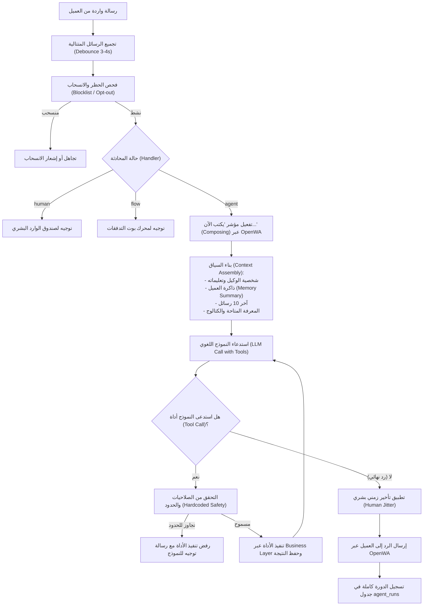

# وثيقة المعمارية الفنية والتصميم الهندسي المحدثة (Technical Design Document - v0.3)

**المشروع:** منصة المتجر والرد على العملاء والتسويق مع وكيل الذكاء الاصطناعي (WhatsApp Commerce & AI Agent Platform)  
**الإصدار:** v0.3 (محدث مع وكيل الذكاء الاصطناعي)  
**التاريخ:** 3 نوفمبر 2026  
**التقنيات:** Electron + Node.js + SQLite (better-sqlite3) + OpenWA + React 19 (Vite, TypeScript, TailwindCSS) + LLM Providers (Gemini / OpenAI / Local Ollama)

---

## 1. المعمارية العامة ومكونات النظام (System Architecture)

يعتمد النظام على بنية متكاملة تضع **وكيل الذكاء الاصطناعي (AI Agent)** كشريك محوري في إدارة عمليات المحادثة والبيع المباشر، مع عزل الأدوات الحساسة وقصر الوصول المالي على قواعد عمل مشفرة وصلبة (Hardcoded Business Layer Guardrails).

```mermaid
graph TB
    subgraph "Renderer Process (React 19 UI)"
        UI["React 19 (Vite + TailwindCSS + RTL)"]
        PreloadBridge["Preload API (contextBridge)<br/>Strictly Typed IPC Invokers & Listeners"]
        SandboxView["Agent Sandbox & Review Panel"]
    end

    subgraph "Electron Main Process (Node.js)"
        IPCRegistry["IPC Handler Registry"]

        subgraph "AI Agent Engine"
            MsgDebouncer["Message Debouncer & Aggregator<br/>(3-5s Window)"]
            ContextBuilder["Context Assembler<br/>(Memory + KB + Live DB + History)"]
            LLMAdapter["Pluggable LLM Provider Adapter<br/>(Gemini / OpenAI / Local Ollama)"]
            ToolDispatcher["Tool Execution Dispatcher<br/>(Function Calling Validation)"]
            SafetyShield["Safety & Prompt-Injection Guardrails"]
            DecisionLogger["Audit & Decision Logger (agent_runs)"]
        end
        
        subgraph "Core Business Services"
            StoreSvc["Store & Catalog Service"]
            OrderSvc["Order & Checkout Engine"]
            FlowEngine["Bot Flow & Keywords Engine"]
            CampaignWorker["Campaign Dispatcher & Queue"]
            CustomerSvc["Customer 360 & Memory Service"]
            KnowledgeSvc["Knowledge Base Service"]
        end

        LocalWebhook["Local Webhook Receiver (127.0.0.1)"]
        ProcessMgr["OpenWA Subprocess Manager"]
        DBManager["SQLite Engine (better-sqlite3 / WAL Mode)"]
    end

    subgraph "Subprocess (OpenWA Gateway)"
        OpenWA["OpenWA NestJS Core (Port: 3001, Bind: 127.0.0.1)"]
    end

    subgraph "External Integrations"
        WhatsAppNet["WhatsApp Network"]
        LLMCloud["Cloud LLM API (User's API Key)"]
        LocalLLM["Local LLM Server (Ollama / Localhost)"]
        PaymentLinks["Custom Payment URLs"]
    end

    UI --> PreloadBridge
    PreloadBridge --> IPCRegistry
    IPCRegistry --> Core Business Services
    IPCRegistry --> AI Agent Engine
    
    LocalWebhook -->|Inbound WhatsApp Events| MsgDebouncer
    MsgDebouncer --> SafetyShield
    SafetyShield --> ContextBuilder
    ContextBuilder --> LLMAdapter
    LLMAdapter <--> LLMCloud
    LLMAdapter <--> LocalLLM
    
    LLMAdapter -->|Tool Calls| ToolDispatcher
    ToolDispatcher -->|Executes Tools with Strict Limits| Core Business Services
    ToolDispatcher --> DecisionLogger
    
    Core Business Services <--> DBManager
    DecisionLogger <--> DBManager
    
    ProcessMgr --> OpenWA
    Core Business Services -->|REST API / HMAC| OpenWA
    OpenWA --> LocalWebhook
    OpenWA <--> WhatsAppNet
    OrderSvc -.-> PaymentLinks
```

---

## 2. معمارية وكيل الذكاء الاصطناعي (AI Agent Engine Architecture)

### 2.1 حلقة المعالجة والتنفيذ (ReAct Execution Loop)



### 2.2 أدوات الوكيل المتاحة (Function Calling Tools Specification)

يتم تزويد النموذج بالأدوات التالية عبر مواصفات JSON Schema واضحة ومقيدة:

| اسم الأداة (Tool) | المعاملات (Parameters) | المخرجات (Result) | قواعد الأمان المفروضة (Enforced Guardrails) |
|---|---|---|---|
| `search_catalog` | `query: string, category?: string, maxPrice?: number` | `ProductSummary[]` | بحث حي في المنتجات النشطة فقط. |
| `get_product` | `productId: string` | `ProductDetails` | جلب المتغيرات والأسعار والمخزون الحي. |
| `check_stock` | `variantId: string` | `{ available: boolean, qty: number }` | فحص المخزون الفعلي المتاح. |
| `get_shipping_quote` | `city: string` | `{ fee: number, freeOver?: number }` | احتساب تكلفة الشحن حسب مناطق التوصيل المحددة. |
| `validate_coupon` | `code: string, subtotal: number` | `{ valid: boolean, discount: number }` | فحص صلاحية الكوبون وقيد الاستخدام. |
| `create_draft_order` | `items: OrderItemDTO[], address: AddressDTO, notes?: string` | `DraftOrder` | حجز مخزون مؤقت (15 دقيقة) والتحقق من سقف مبلغ الطلب. |
| `create_payment_link` | `orderId: string` | `{ paymentUrl: string }` | إنشاء رابط دفع مخصص للطلب (لا يملك الوكيل صلاحية تعديل السعر). |
| `get_order_status` | `orderId?: string` | `OrderStatusDetails` | استعلام عن طلب العميل الحالي فقط (يمنع قطعياً استعلام طلب عميل آخر). |
| `send_media` | `mediaPath: string, caption?: string` | `{ success: boolean }` | إرسال صورة منتج أو ملف بروشور للعميل. |
| `handoff_to_human` | `reason: string, summary: string` | `{ success: boolean }` | تحويل المحادثة لموظف وإيقاف الوكيل فوراً للمحادثة. |
| `tag_contact` | `tags: string[]` | `{ success: boolean }` | وسم اهتمامات العميل في ملفه الشخصي. |

> [!CAUTION]
> **عزل مفاتيح المنتجات الرقمية والتراخيص (Digital License Keys Isolation):**  
> لا يمتلك الوكيل أي أداة لقراءة مفاتيح التراخيص أو جدول `license_keys`. يتم تسليم المفتاح حصرياً بواسطة `OrderService` في طبقة الأعمال بعد تأكيد السداد الفعلي من قبل التاجر أو بوابة الدفع.

---

## 3. حواجز الأمان ومكافحة حقن التعليمات (Security & Guardrails)

1. **التحقق البرمجي الصلب (Hard Constraints in Code):**
   - حدود الخصومات لا تُترك لتقدير موظف الذكاء الاصطناعي فقط، بل تفحصها دالة `create_draft_order` في كود الـ TypeScript؛ إذا تجاوز الخصم النسبة المحددة في `agent_config.limits_json` (مثلاً 10%)، يُرفض الطلب تلقائياً ويُفرض التحويل لموظف بشري (`handoff_to_human`).
   - سقف المبالغ المالية: أي طلب يتجاوز القيمة المحددة (مثلاً 500$) يتحول تلقائياً إلى وضع المراجعة البشرية (Semi-autonomous / Human Review).
2. **التحصين ضد حقن التعليمات (Prompt Injection Defense):**
   - يتم التعامل مع كل رسائل العملاء كبيانات نصية غير موثوقة (Untrusted User Inputs) معزولة داخل وسوم محددة `<customer_message>`.
   - يتم تزويد النموذج بتعليمات صارمة: عدم كشف التعليمات الداخلية (System Prompt)، عدم تغيير الهوية أو تعديل الأسعار المخزنة في قاعدة البيانات تحت أي ظرف، وعدم تأكيد أي وعود خارج نطاق الكتالوج.
3. **زر الإيقاف الطارئ (Emergency Kill Switch):**
   - زر بارز في واجهة المستخدم يرسل حدث IPC فوري `agent:emergency-stop` يقوم بتعطيل الوكيل في كل الجلسات وتحويل المحادثات فوراً إلى الوضع الاقتراحي (Suggestive) أو البشري (Human).

---

## 4. عقود الـ IPC الخاصة بالوكيل والمعرفة (Agent & Knowledge IPC Contracts)

| القناة (Channel) | النوع | المعاملات (Payload) | المخرجات (Response) | الوصف |
|---|---|---|---|---|
| `agent:get-config` | `invoke` | `{}` | `AgentConfigDTO` | جلب إعدادات الوكيل، الشخصية، والحدود |
| `agent:update-config` | `invoke` | `UpdateAgentConfigDTO` | `{ success: boolean }` | تحديث نبرة الوكيل، اللهجة، وحدود الخصم |
| `agent:set-mode` | `invoke` | `{ sessionId?: string, conversationId?: string, mode: AgentMode }` | `{ success: boolean }` | تغيير وضع الوكيل (مستقل / شبه مستقل / اقتراحي / معطل) |
| `agent:emergency-stop`| `invoke` | `{}` | `{ stopped: boolean }` | إيقاف طارئ شامل لجميع الجلسات فوراً |
| `agent:test-sandbox` | `invoke` | `{ prompt: string, history: ChatMessageDTO[] }` | `AgentSandboxResponseDTO` | تجربة محادثة مع الوكيل داخل التطبيق (Sandbox) |
| `agent:list-runs` | `invoke` | `AgentRunFilterDTO` | `AgentRunSummary[]` | استعراض سجل قرارات الوكيل والأدوات المستدعاة |
| `agent:review-run` | `invoke` | `{ runId: string, rating: 'GOOD' \| 'BAD', correction?: string }` | `{ success: boolean }` | تقييم وتصحيح رد الوكيل لتحسين الأداء |
| `knowledge:list` | `invoke` | `{}` | `KnowledgeItem[]` | استعراض عناصر قاعدة المعرفة والأسئلة الشائعة |
| `knowledge:create` | `invoke` | `CreateKnowledgeDTO` | `KnowledgeItem` | إضافة نص معرفي أو سياسة متجر جديدة |
| `knowledge:update` | `invoke` | `UpdateKnowledgeDTO` | `KnowledgeItem` | تعديل عنصر معرفي |
| `knowledge:delete` | `invoke` | `{ id: string }` | `{ success: boolean }` | حذف عنصر معرفي |

---

## 5. نموذج قاعدة البيانات الكامل المحدث (Updated SQLite DDL Schema)

تم تحديث نموذج البيانات ليتضمن الجداول الأربعة المخصصة للوكيل والمعرفة (`agent_config`, `knowledge_items`, `agent_runs`, `agent_reviews`) مع الحقول الجديدة:

```sql
PRAGMA journal_mode = WAL;
PRAGMA foreign_keys = ON;
PRAGMA synchronous = NORMAL;

-- 1. الجلسات وأرقام الواتساب
CREATE TABLE IF NOT EXISTS sessions (
    id TEXT PRIMARY KEY,
    name TEXT NOT NULL,
    phone TEXT,
    status TEXT NOT NULL DEFAULT 'DISCONNECTED', -- CONNECTED, DISCONNECTED, QR_READY
    proxy TEXT,
    agent_mode TEXT DEFAULT 'AUTONOMOUS', -- AUTONOMOUS, SEMI_AUTONOMOUS, SUGGESTIVE, DISABLED
    created_at DATETIME DEFAULT CURRENT_TIMESTAMP
);

-- 2. جهات الاتصال والعملاء مع ذاكرة الوكيل
CREATE TABLE IF NOT EXISTS contacts (
    id TEXT PRIMARY KEY,
    phone TEXT UNIQUE NOT NULL,
    name TEXT,
    tags TEXT, -- JSON Array of strings e.g. ["VIP", "Physical"]
    opted_out INTEGER DEFAULT 0,
    address_json TEXT, -- Default shipping address
    memory_summary TEXT, -- ذاكرة ملخصة لتفضيلات العميل وشكاويه السابقة
    source TEXT DEFAULT 'WHATSAPP',
    created_at DATETIME DEFAULT CURRENT_TIMESTAMP
);

-- 3. المحادثات وحالة المسؤول عنها
CREATE TABLE IF NOT EXISTS conversations (
    id TEXT PRIMARY KEY,
    session_id TEXT REFERENCES sessions(id) ON DELETE CASCADE,
    contact_id TEXT REFERENCES contacts(id) ON DELETE CASCADE,
    handler TEXT NOT NULL DEFAULT 'agent', -- 'flow', 'agent', 'human'
    state TEXT NOT NULL DEFAULT 'open', -- 'open', 'waiting_human', 'closed'
    assignee TEXT,
    unread_count INTEGER DEFAULT 0,
    last_message_at DATETIME,
    created_at DATETIME DEFAULT CURRENT_TIMESTAMP
);

-- 4. الرسائل
CREATE TABLE IF NOT EXISTS messages (
    id TEXT PRIMARY KEY,
    conversation_id TEXT REFERENCES conversations(id) ON DELETE CASCADE,
    direction TEXT NOT NULL, -- INBOUND, OUTBOUND
    type TEXT NOT NULL DEFAULT 'text', -- text, image, document, audio
    body TEXT,
    media_path TEXT,
    status TEXT DEFAULT 'SENT', -- SENT, DELIVERED, READ, FAILED
    ts DATETIME DEFAULT CURRENT_TIMESTAMP
);

-- 5. إعدادات وكيل الذكاء الاصطناعي وحدود الأمان
CREATE TABLE IF NOT EXISTS agent_config (
    id TEXT PRIMARY KEY DEFAULT 'default',
    persona_name TEXT NOT NULL DEFAULT 'مساعد المتجر الذكي',
    tone TEXT NOT NULL DEFAULT 'friendly', -- 'formal', 'friendly', 'sales_focused'
    languages TEXT DEFAULT '["ar", "en"]', -- اللغات واللهجات المدعومة
    system_instructions TEXT, -- تعليمات المالك الخاصة
    max_discount_percent REAL DEFAULT 10.0, -- أقصى نسبة خصم يسمح بها
    max_order_amount_auto REAL DEFAULT 200.0, -- أقصى قيمة طلب بدون مراجعة بشرية
    daily_cost_limit REAL DEFAULT 10.0, -- سقف التكلفة اليومية بالدولار
    provider TEXT DEFAULT 'gemini', -- 'gemini', 'openai', 'ollama'
    model_name TEXT DEFAULT 'gemini-1.5-flash',
    created_at DATETIME DEFAULT CURRENT_TIMESTAMP,
    updated_at DATETIME DEFAULT CURRENT_TIMESTAMP
);

-- 6. بنك المعرفة والأسئلة الشائعة وسياسات المتجر
CREATE TABLE IF NOT EXISTS knowledge_items (
    id TEXT PRIMARY KEY,
    title TEXT NOT NULL,
    category TEXT DEFAULT 'general', -- 'faq', 'shipping', 'return_policy', 'product_guide'
    content TEXT NOT NULL,
    source TEXT DEFAULT 'OWNER_INPUT',
    active INTEGER DEFAULT 1,
    created_at DATETIME DEFAULT CURRENT_TIMESTAMP,
    updated_at DATETIME DEFAULT CURRENT_TIMESTAMP
);

-- 7. سجل تشغيل وقرارات الوكيل (Decision Audit Log)
CREATE TABLE IF NOT EXISTS agent_runs (
    id TEXT PRIMARY KEY,
    conversation_id TEXT REFERENCES conversations(id) ON DELETE CASCADE,
    user_input TEXT NOT NULL,
    context_used_json TEXT,
    tools_called_json TEXT, -- تفاصيل الأدوات المنفذة مع المدخلات والمخرجات
    agent_output TEXT NOT NULL,
    prompt_tokens INTEGER DEFAULT 0,
    completion_tokens INTEGER DEFAULT 0,
    cost_estimate REAL DEFAULT 0.0,
    latency_ms INTEGER,
    confidence_score REAL,
    ts DATETIME DEFAULT CURRENT_TIMESTAMP
);

-- 8. تقييم وتصحيح أداء الوكيل (Human Review & RLHF)
CREATE TABLE IF NOT EXISTS agent_reviews (
    id TEXT PRIMARY KEY,
    run_id TEXT REFERENCES agent_runs(id) ON DELETE CASCADE,
    rating TEXT NOT NULL, -- 'GOOD', 'BAD'
    correction_text TEXT,
    applied_to_kb INTEGER DEFAULT 0,
    reviewed_by TEXT,
    reviewed_at DATETIME DEFAULT CURRENT_TIMESTAMP
);

-- 9. المنتجات
CREATE TABLE IF NOT EXISTS products (
    id TEXT PRIMARY KEY,
    name TEXT NOT NULL,
    type TEXT NOT NULL, -- 'physical' OR 'digital'
    description TEXT,
    media TEXT, -- JSON Array of image paths/URLs
    category TEXT,
    active INTEGER DEFAULT 1,
    created_at DATETIME DEFAULT CURRENT_TIMESTAMP
);

-- 10. متغيرات المنتجات والمخزون
CREATE TABLE IF NOT EXISTS variants (
    id TEXT PRIMARY KEY,
    product_id TEXT REFERENCES products(id) ON DELETE CASCADE,
    sku TEXT UNIQUE NOT NULL,
    options_json TEXT,
    price REAL NOT NULL,
    currency TEXT DEFAULT 'USD',
    stock_qty INTEGER NOT NULL DEFAULT 0,
    reserved_qty INTEGER NOT NULL DEFAULT 0
);

-- 11. الأصول والتراخيص الرقمية
CREATE TABLE IF NOT EXISTS digital_assets (
    id TEXT PRIMARY KEY,
    product_id TEXT REFERENCES products(id) ON DELETE CASCADE,
    plan TEXT NOT NULL,
    file_path TEXT,
    download_url_template TEXT
);

-- 12. مخزن مفاتيح التراخيص (محجوب تماماً عن الوكيل)
CREATE TABLE IF NOT EXISTS license_keys (
    id TEXT PRIMARY KEY,
    product_id TEXT REFERENCES products(id) ON DELETE CASCADE,
    key_code TEXT NOT NULL,
    status TEXT NOT NULL DEFAULT 'available', -- 'available', 'sold', 'revoked'
    order_id TEXT,
    sold_at DATETIME
);

-- 13. مناطق الشحن
CREATE TABLE IF NOT EXISTS shipping_zones (
    id TEXT PRIMARY KEY,
    name TEXT NOT NULL,
    cities_json TEXT NOT NULL,
    fee REAL NOT NULL DEFAULT 0.0,
    free_over REAL
);

-- 14. الطلبات
CREATE TABLE IF NOT EXISTS orders (
    id TEXT PRIMARY KEY,
    contact_id TEXT REFERENCES contacts(id),
    source TEXT NOT NULL DEFAULT 'agent', -- 'agent', 'flow', 'human'
    status TEXT NOT NULL DEFAULT 'NEW',
    payment_method TEXT NOT NULL, -- 'PAYMENT_LINK', 'COD', 'BANK_TRANSFER'
    payment_link TEXT,
    payment_status TEXT DEFAULT 'PENDING',
    subtotal REAL NOT NULL,
    discount_amount REAL DEFAULT 0.0,
    shipping_fee REAL DEFAULT 0.0,
    total REAL NOT NULL,
    notes TEXT,
    created_at DATETIME DEFAULT CURRENT_TIMESTAMP
);

-- 15. عناصر الطلب
CREATE TABLE IF NOT EXISTS order_items (
    id TEXT PRIMARY KEY,
    order_id TEXT REFERENCES orders(id) ON DELETE CASCADE,
    variant_id TEXT REFERENCES variants(id),
    product_name TEXT NOT NULL,
    variant_desc TEXT,
    qty INTEGER NOT NULL,
    unit_price REAL NOT NULL
);

-- 16. الشحنات
CREATE TABLE IF NOT EXISTS shipments (
    id TEXT PRIMARY KEY,
    order_id TEXT REFERENCES orders(id) ON DELETE CASCADE,
    address_json TEXT NOT NULL,
    carrier TEXT,
    tracking_no TEXT,
    tracking_url TEXT,
    status TEXT DEFAULT 'PREPARING',
    shipped_at DATETIME,
    delivered_at DATETIME
);

-- 17. المرتجعات
CREATE TABLE IF NOT EXISTS returns (
    id TEXT PRIMARY KEY,
    order_id TEXT REFERENCES orders(id) ON DELETE CASCADE,
    reason TEXT,
    status TEXT DEFAULT 'REQUESTED',
    restocked INTEGER DEFAULT 0,
    created_at DATETIME DEFAULT CURRENT_TIMESTAMP
);

-- 18. الفواتير
CREATE TABLE IF NOT EXISTS invoices (
    id TEXT PRIMARY KEY,
    order_id TEXT REFERENCES orders(id) ON DELETE CASCADE,
    invoice_number TEXT UNIQUE NOT NULL,
    pdf_path TEXT,
    created_at DATETIME DEFAULT CURRENT_TIMESTAMP
);

-- 19. الكوبونات
CREATE TABLE IF NOT EXISTS coupons (
    id TEXT PRIMARY KEY,
    code TEXT UNIQUE NOT NULL,
    discount_type TEXT NOT NULL,
    discount_value REAL NOT NULL,
    expires_at DATETIME,
    max_uses INTEGER DEFAULT 100,
    times_used INTEGER DEFAULT 0
);

-- 20. الحملات التسويقية
CREATE TABLE IF NOT EXISTS campaigns (
    id TEXT PRIMARY KEY,
    name TEXT NOT NULL,
    template TEXT NOT NULL,
    media_path TEXT,
    status TEXT DEFAULT 'DRAFT',
    scheduled_at DATETIME,
    min_delay_sec INTEGER DEFAULT 20,
    max_delay_sec INTEGER DEFAULT 45,
    daily_limit INTEGER DEFAULT 200,
    created_at DATETIME DEFAULT CURRENT_TIMESTAMP
);

-- 21. مستلمو الحملات
CREATE TABLE IF NOT EXISTS campaign_recipients (
    id TEXT PRIMARY KEY,
    campaign_id TEXT REFERENCES campaigns(id) ON DELETE CASCADE,
    contact_id TEXT REFERENCES contacts(id),
    status TEXT DEFAULT 'PENDING',
    sent_at DATETIME,
    error_message TEXT
);

-- 22. تدفقات البوت القديمة والكلمات المفتاحية
CREATE TABLE IF NOT EXISTS bot_flows (
    id TEXT PRIMARY KEY,
    name TEXT NOT NULL,
    trigger_keyword TEXT,
    match_type TEXT DEFAULT 'contains',
    content_json TEXT NOT NULL,
    priority INTEGER DEFAULT 10,
    enabled INTEGER DEFAULT 1
);

-- 23. قائمة الحظر والانسحاب
CREATE TABLE IF NOT EXISTS blocklist (
    phone TEXT PRIMARY KEY,
    reason TEXT DEFAULT 'OPT_OUT',
    added_at DATETIME DEFAULT CURRENT_TIMESTAMP
);

-- 24. سجل التدقيق
CREATE TABLE IF NOT EXISTS audit_log (
    id TEXT PRIMARY KEY,
    actor TEXT NOT NULL,
    action TEXT NOT NULL,
    entity TEXT NOT NULL,
    entity_id TEXT,
    details_json TEXT,
    ts DATETIME DEFAULT CURRENT_TIMESTAMP
);

-- الفهارس الأساسية
CREATE INDEX IF NOT EXISTS idx_contacts_phone ON contacts(phone);
CREATE INDEX IF NOT EXISTS idx_messages_conv_ts ON messages(conversation_id, ts DESC);
CREATE INDEX IF NOT EXISTS idx_orders_status_date ON orders(status, created_at DESC);
CREATE INDEX IF NOT EXISTS idx_agent_runs_conv_ts ON agent_runs(conversation_id, ts DESC);
CREATE INDEX IF NOT EXISTS idx_knowledge_category ON knowledge_items(category, active);
```

---

## 6. الهيكل المحدث لشجرة ملفات المشروع (Updated Directory Structure)

```plaintext
whatsapp-store-bot-marketing/
├── docs/
│   ├── PRD.md
│   └── TECHNICAL_DESIGN.md
├── src/
│   ├── main/                  # Electron Main Process
│   │   ├── index.ts
│   │   ├── ipc/               # معالجات قنوات IPC
│   │   │   ├── agent.ipc.ts       # إعدادات الوكيل، الـ Sandbox، وسجل القرارات
│   │   │   ├── knowledge.ipc.ts   # إدارة بنك المعرفة والأسئلة الشائعة
│   │   │   ├── catalog.ipc.ts
│   │   │   ├── chat.ipc.ts
│   │   │   ├── orders.ipc.ts
│   │   │   └── session.ipc.ts
│   │   ├── agent/             # محرك وكيل الذكاء الاصطناعي
│   │   │   ├── agent-engine.ts         # المنسق العام لحلقة ReAct
│   │   │   ├── context-builder.ts      # تجميع الذاكرة والمعرفة
│   │   │   ├── debouncer.ts            # تجميع الرسائل المتتالية
│   │   │   ├── tools/                  # تنفيذ أدوات الـ Function Calling
│   │   │   │   ├── catalog.tools.ts
│   │   │   │   ├── order.tools.ts
│   │   │   │   ├── shipping.tools.ts
│   │   │   │   └── handoff.tools.ts
│   │   │   ├── guardrails/             # فحص الحدود الصلبة ومكافحة الاختراق
│   │   │   │   ├── discount-guard.ts
│   │   │   │   └── injection-guard.ts
│   │   │   └── providers/              # مزودو النماذج
│   │   │       ├── llm-provider.interface.ts
│   │   │       ├── gemini.provider.ts
│   │   │       ├── openai.provider.ts
│   │   │       └── ollama.provider.ts
│   │   ├── services/          # خدمات النطاق التجاري
│   │   │   ├── store.service.ts
│   │   │   ├── order.service.ts
│   │   │   ├── webhook-server.service.ts
│   │   │   └── openwa-manager.service.ts
│   │   └── database/          # إدارة SQLite
│   │       ├── db.ts
│   │       └── schema.sql
│   ├── preload/               # Preload Script مع حماية contextBridge
│   │   ├── index.ts
│   │   └── contracts.ts
│   ├── renderer/              # واجهة React 19 المكتبية
│   │   ├── src/
│   │   │   ├── views/
│   │   │   │   ├── Store/     # المتجر والمنتجات والطلبات
│   │   │   │   ├── Inbox/     # صندوق المحادثات الموحد (مع إمكانية تبديل الوضع للوكيل)
│   │   │   │   ├── Marketing/ # الحملات والتسويق المقسم
│   │   │   │   ├── Agent/     # إعدادات الوكيل، بنك المعرفة، الـ Sandbox، ومراجعة القرارات
│   │   │   │   └── Shared/    # العملاء، التقارير والإدارة المشتركة
│   │   │   └── ...
│   └── shared/                # الواجهات والأنماط المشتركة
│       ├── types.ts
│       └── agent-types.ts
```
