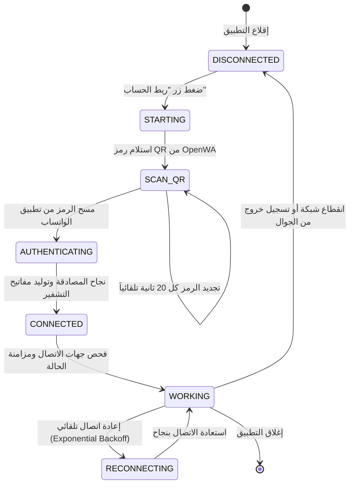
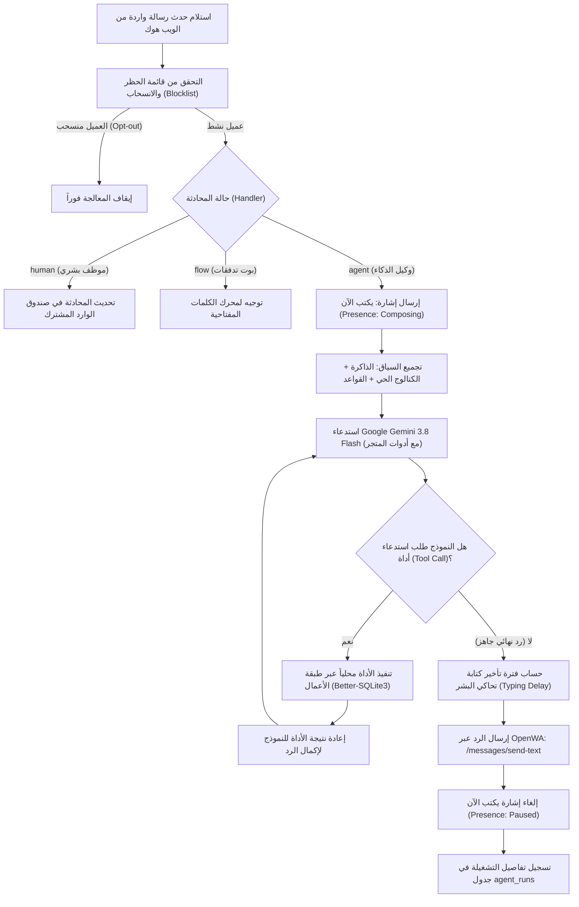

# خطة قنوات الربط الفني لواتساب والدمج المعماري مع OpenWA
## Technical Connection Channels & OpenWA Gateway Integration Plan

**المشروع:** منصة المتجر والرد على العملاء والتسويق مع وكيل الذكاء الاصطناعي (WaSell)  
**المستودع المعتمد للربط:** [rmyndharis/OpenWA](https://github.com/rmyndharis/OpenWA)  
**الإصدار:** v1.0 (معتمد للإنتاج)  
**التقنيات الأساسية:** Electron Main (Node.js) + React 19 UI + OpenWA Gateway (NestJS/TypeScript/Baileys) + SQLite (better-sqlite3) + Google Gemini API  

---

## 1. الملخص التنفيذي ومبررات الاعتماد الفني

تهدف هذه الخطة إلى وضع الهيكلية الهندسية الشاملة لربط وتشغيل قنوات واتساب داخل تطبيق **WaSell** عبر الاعتماد المباشر على بوابة **OpenWA** مفتوحة المصدر والمستضافة ذاتياً ([rmyndharis/OpenWA](https://github.com/rmyndharis/OpenWA)).

### 1.1 لماذا تم اختيار rmyndharis/OpenWA؟
1. **صفر تكلفة محادثات (Zero Per-Message Cost):** بخلاف بوابة Meta Cloud API التي تفرض تسعيرة متصاعدة على كل محادثة تسويقية أو بيعية، توفر OpenWA ربطاً مجانياً عبر مسح رمز الاستجابة السريعة (Multi-Device QR Code).
2. **استقلالية وسيادة تامة على البيانات (Full Data Ownership):** يعمل الخادم محلياً أو داخل حاوية Docker خاصة بالمتجر دون مرور بيانات العملاء وسجلات المحادثات عبر أي وسيط سحابي خارجي.
3. **معمارية متعددة المحركات (Pluggable Engines):** تتيح OpenWA التبديل السلس بين محركين أساسيين عبر متغير البيئة `ENGINE_TYPE`:
   - `whatsapp-web.js`: يعتمد على رأس متصفح Chromium/Puppeteer عالي الاستقرار والواقعية.
   - `baileys`: خفيف الوزن، يعتمد على اتصالات WebSocket مباشرة بدون استهلاك موارد المتصفح.
4. **تكامل متقدم مع وكيل الذكاء الاصطناعي (AI Agent Friendly):** يدعم بروتوكول OpenWA مؤشرات الكتابة الحية (`presence: composing`)، إرسال الوسائط والملفات والكتالوج، وتفاعل الـ Webhooks في أجزاء من الثانية.

---

## 2. المعمارية العامة لنظام القنوات والمحرك الثنائي (Dual-Engine Architecture)

يوفر تطبيق WaSell معمارية مرنة تدعم **المحرك الثنائي** مع نظام توجيه ذكي (Smart Channel Router):

```mermaid
graph TB
    subgraph "Renderer Process (React 19 UI)"
        UI["واجهة المستخدم (ChannelsPage.tsx)"]
        QrModal["نافذة مسح الرمز (OpenWAQrModal.tsx)"]
        LiveStream["سجل الويب هوك الحي (LiveWebhookStreamCard.tsx)"]
    end

    subgraph "Electron Main Process (Node.js)"
        Router["موجّه القنوات الذكي (Channel Router)"]
        OpenWAMgr["مدير بوابة OpenWA (OpenWAManager.service)"]
        WabaSvc["مزود سحابة Meta (WabaCloud.service)"]
        WebhookServer["خادم الويب هوك المحلي (WebhookServer.service :3005)"]
        AgentEngine["محرك وكيل الذكاء الاصطناعي (AIAgentEngine)"]
        LocalDB[(قاعدة بيانات SQLite / WAL)]
    end

    subgraph "خادم بوابة OpenWA (rmyndharis/OpenWA :2785)"
        OpenWACore["OpenWA NestJS Runtime"]
        EngineSelector{"نوع المحرك (ENGINE_TYPE)"}
        BaileysCore["Baileys Engine (WebSockets)"]
        WppWebCore["WhatsApp-Web.js (Puppeteer)"]
        LocalSessionStore["تخزين الجلسة ومفاتيح التشفير"]
    end

    subgraph "شبكة واتساب العالمية"
        WANetwork["خوادم WhatsApp الرسمية"]
    end

    UI <-->|IPC Channels| Router
    QrModal <-->|IPC: session:qr-event| OpenWAMgr
    Router -->|القناة الأساسية: تفاعلي ومبيعات| OpenWAMgr
    Router -.->|القناة البديلة: حملات رسمية| WabaSvc

    OpenWAMgr -->|REST API + X-API-Key :2785| OpenWACore
    OpenWACore --> EngineSelector
    EngineSelector --> BaileysCore
    EngineSelector --> WppWebCore
    EngineSelector <--> LocalSessionStore
    BaileysCore <--> WANetwork
    WppWebCore <--> WANetwork

    WANetwork -->|Inbound Events| OpenWACore
    OpenWACore -->|HTTP POST Webhooks + HMAC| WebhookServer
    WebhookServer -->|تجميع الرسائل المتتالية (Debounce)| AgentEngine
    WebhookServer -->|تحديث الحالة والرسائل| LocalDB
    WebhookServer -.->|بث الأحداث الحية| LiveStream
```

---

## 3. مواصفات واجهات برمجة OpenWA المعتمدة (API Specification)

يعتمد الربط مع خادم OpenWA على ترويسة المصادقة الموحدة:
- **Header:** `X-API-Key: {SECURE_GENERATED_KEY}`
- **Content-Type:** `application/json`
- **Host & Port:** `http://127.0.0.1:2785`

| المسار (Endpoint) | الطريقة (Method) | الوظيفة | الاستخدام في WaSell |
|---|---|---|---|
| `/api/sessions` | `POST` | إنشاء جلسة جديدة وتعيين رابط الـ Webhook | تهيئة جلسة المتجر لأول مرة |
| `/api/sessions/{sessionId}` | `GET` | الاستعلام عن بيانات وحالة الجلسة | مراقبة الاتصال ومستوى التأخير (Latency) |
| `/api/sessions/{sessionId}/start` | `POST` | بدء تشغيل عميل الواتساب للجلسة | تفعيل الجلسة واستدعاء رمز الاقتران |
| `/api/sessions/{sessionId}/qr` | `GET` | استخراج كود الـ QR كـ Data URL أو SVG | عرضه فوراً في نافذة الاقتران |
| `/api/sessions/{sessionId}/messages/send-text` | `POST` | إرسال رسالة نصية للعميل | ردود الوكيل الذكي ورسائل الحملات |
| `/api/sessions/{sessionId}/messages/send-media` | `POST` | إرسال صور المنتجات، الملفات الرقمية، الفواتير | تسليم الروابط، عروض الأسعار، وتأكيدات الطلب |
| `/api/sessions/{sessionId}/chats/presence` | `POST` | تغيير حالة المحادثة (`composing` / `paused`) | إظهار مؤشر "يكتب الآن..." أثناء تفكير الوكيل |
| `/api/sessions/{sessionId}/stop` | `POST` | إيقاف الجلسة مؤقتاً | الإيقاف الطارئ أو الصيانة |
| `/api/sessions/{sessionId}` | `DELETE` | تسجيل الخروج وحذف بيانات الاعتماد | فك ارتباط الرقم عند الرغبة في تغيير الحساب |

---

## 4. دورة حياة الجلسة وإجراءات الاقتران (Session Lifecycle & QR Flow)

### 4.1 آلة حالات الجلسة (Session State Machine)



### 4.2 مخطط تسلسل عملية الاقتران ومسح الرمز (Sequence Diagram)

```mermaid
sequenceDiagram
    autonumber
    actor User as المالك (المستخدم)
    participant UI as واجهة React (OpenWAQrModal)
    participant Main as Electron Main (OpenWAManager)
    participant Gateway as خادم OpenWA (:2785)
    participant WA as شبكة WhatsApp

    User->>UI: النقر على "ربط رقم جديد / مسح رمز QR"
    UI->>Main: استدعاء IPC: session:start
    Main->>Gateway: POST /api/sessions (إنشاء وتعيين Webhook)
    Gateway-->>Main: تأكيد إنشاء الجلسة { sessionId: "wasell_main_store" }
    Main->>Gateway: POST /api/sessions/{sessionId}/start
    Gateway->>WA: تهيئة اتصال بروتوكول Multi-Device
    WA-->>Gateway: استلام مفتاح الاقتران الخام
    Gateway-->>Main: حدث QR Code جاهز
    Main->>Gateway: GET /api/sessions/{sessionId}/qr
    Gateway-->>Main: { qr: "data:image/png;base64,..." }
    Main->>UI: إرسال حدث IPC: session:qr-event { qrCodeDataUrl }
    UI->>User: عرض رمز QR مع عداد تنازلي (20s)
    User->>WA: مسح الرمز عبر الهاتف (الأجهزة المرتبطة)
    WA->>Gateway: تأكيد الاقتران والمصادقة
    Gateway->>Main: إرسال Webhook: session.status = "WORKING"
    Main->>Main: تحديث جدول sessions (status = 'CONNECTED')
    Main->>UI: إرسال حدث IPC: session:status-changed { status: 'CONNECTED' }
    UI->>User: إغلاق النافذة المنبثقة وعرض شارة "متصل ونشط"
```

---

## 5. خط أنابيب استقبال وتطبيع الأحداث (Inbound Webhook Pipeline)

### 5.1 خادم الويب هوك المحلي (Local Webhook Server)
- يعمل داخل Electron Main على العنوان المحلي الآمن: `http://127.0.0.1:3005/webhook/openwa`.
- **أمان الاتصال:** فحص توقيع HMAC المرفق في ترويسة `X-OpenWA-Signature` والتأكد من مطابقة الـ Secret.

### 5.2 خريطة تطبيع الأحداث (Event Normalization)

```typescript
export interface NormalizedWhatsAppEvent {
  eventId: string;
  eventType: 'MESSAGE_RECEIVED' | 'MESSAGE_STATUS' | 'SESSION_STATUS';
  timestamp: number;
  sessionId: string;
  data: {
    messageId?: string;
    fromPhone?: string;       // e.g. "966501234567"
    contactName?: string;     // pushName
    bodyText?: string;
    mediaUrl?: string;
    mediaType?: 'image' | 'audio' | 'document' | 'video';
    deliveryStatus?: 'SENT' | 'DELIVERED' | 'READ' | 'FAILED';
    sessionStatus?: string;
  };
}
```

### 5.3 تجميع الرسائل المتتالية (Inbound Message Debouncer)
عندما يرسل العميل عدة رسائل متتابعة في ثوانٍ معدودة (مثل: *"السلام عليكم"* ثم *"هل متوفر سماعات؟"* ثم *"وبكم سعرها؟"*):
1. يلتقط خادم الـ Webhook كل رسالة ويخزنها فوراً في جدول `messages` كرسالة غير معالجة.
2. يتم تشغيل مؤقت انتظار ذكي (Debounce Window مدتها 3.5 ثانية).
3. عند انتهاء المؤقت، تُدمج الرسائل في سياق حواري واحد وتُسلّم لمحرك الوكيل الذكي دفعة واحدة.
4. **الفائدة:** منع الوكيل من الرد على التحية فقط وتفويت السؤال الأساسي، وتوفير استهلاك الـ Tokens.

---

## 6. حلقة التفاعل مع وكيل الذكاء الاصطناعي (AI Agent ReAct Loop)



### 6.1 أدوات المتجر المتاحة للوكيل عبر الواتساب (Function Calling Tools)

| الأداة | الوصف | التأثير على قاعدة البيانات |
|---|---|---|
| `search_catalog` | بحث في المنتجات بالاسم أو الفئة أو الميزانية | قراءة فقط من `products` و `variants` |
| `get_product` | جلب تفاصيل منتج ومتغيراته وصوره | قراءة فقط |
| `check_stock` | فحص المخزون الحي الدقيق لأي SKU | قراءة فقط مع استبعاد الكميات المحجوزة |
| `get_shipping_quote` | حساب تكلفة الشحن وموعد التوصيل حسب المدينة | قراءة من `shipping_zones` |
| `create_draft_order` | إنشاء مسودة طلب بعد جمع بيانات العميل | كتابة في `orders` بحالة `DRAFT` مع سقف أقصى 200$ |
| `create_payment_link` | إنشاء وتمرير رابط الدفع الإلكتروني المباشر | توليد رابط وإدراجه في رسالة العميل |
| `handoff_to_human` | تحويل المحادثة لموظف بشري فوراً | تعديل `handler='human'` مع ملخص للموظف |

---

## 7. استراتيجية مكافحة الحظر والأمان التشغيلي (Anti-Ban & Safety Protocol)

نظراً لأن بوابة OpenWA تعتمد على بروتوكول واتساب للأجهزة المتعددة، تم تضمين حزمة إجراءات أمان صارمة داخل النظام:

### 7.1 محاكاة السلوك البشري (Human-Like Simulation)
1. **تأخير الكتابة الديناميكي (Dynamic Typing Delay):**
   $$\text{Delay (ms)} = \min(5000, \max(1500, \text{Chars Count} \times 60))$$
   يضمن أن رسالة من 50 حرفاً تنتظر حوالي 3 ثوانٍ مع ظهور مؤشر "يكتب الآن..." لدى العميل قبل وصول الرسالة.
2. **جدولة الحملات التسويقية (Campaign Jitter):**
   - الفاصل الزمني الإجباري بين الرسائل التسويقية: بين **20 إلى 45 ثانية عشوائية**.
   - الحد الأقصى اليومي الافتراضي لكل رقم متجر: **150 - 200 رسالة يومياً**.

### 7.2 جدول الإحماء للأرقام الجديدة (Warm-Up Schedule)
عند ربط رقم واتساب جديد لم يسبق له إرسال رسائل جماعية، يفرض النظام تلقائياً قيود إرسال تصاعدية:

| الأيام | الحد الأقصى اليومي | نوع الرسائل المسموح |
|---|---|---|
| اليوم 1 - 3 | 20 رسالة / يوم | ردود تفاعلية على العملاء الواردين فقط |
| اليوم 4 - 7 | 50 رسالة / يوم | ردود واردة + إشعارات الطلبات المؤكدة |
| اليوم 8 - 14 | 100 رسالة / يوم | مبيعات + حملات مصغرة ذات استهداف دقيق |
| اليوم 15 وما بعده | 200+ رسالة / يوم | حملات كاملة مع الحفاظ على الفواصل العشوائية |

### 7.3 إدارة الانسحاب الفوري (Instant Opt-Out)
- عند استقبال أي كلمة تفيد الرغبة في التوقف (مثل: *"إيقاف"*، *"الغاء"*، *"stop"*، *"unsubscribe"*):
  - يتم إدراج الرقم فوراً في جدول `blocklist`.
  - يتم تعيين `opted_out = 1` في جدول `contacts`.
  - يُحظر خادم الإرسال من توجيه أي رسالة تسويقية مستقبلية للرقم تحت أي ظرف.

### 7.4 دعم البروكسي (Proxy Support)
- تدعم OpenWA ضبط بروكسي مخصص لكل جلسة (HTTP/SOCKS5) لضمان ثبات عنوان الـ IP وعدم تسببه في تنبيه أنظمة كشف السلوك غير المعتاد في واتساب.

---

## 8. الربط مع شاشات واجهة المستخدم (UI Components Mapping)

تمت مواءمة واجهة التطبيق المكتبي (المبنية على تصميم Stitch الشاشة رقم 09) مباشرة مع خدمات الربط:

| المكون في الواجهة (`src/renderer/src/features/channels/components`) | الوظيفة الفنية المرتبطة |
|---|---|
| `ProviderSelectorCard.tsx` | التبديل بين `openwa_gateway` و `meta_cloud` و `hybrid` |
| `OpenWACard.tsx` | عرض حالة اتصال البوابة، رقم الهاتف المقترن، زمن الاستجابة (Latency)، وأزرار الإطلاق وقطع الاتصال |
| `OpenWAQrModal.tsx` | نافذة منبثقة تفاعلية تعرض رمز الـ QR مع مؤشر العد التنازلي لإعادة التوليد وزر التحديث اليدوي |
| `LiveWebhookStreamCard.tsx` | مراقبة مباشرة لجميع أحداث الـ Webhook الواردة والصادرة مع إمكانية مسح السجل واختبار الاتصال |
| `ChannelsKpis.tsx` | بطاقات قياس زمن الاستجابة (Server Health)، جاهزية الـ Webhook، وعدد الرسائل المعالجة |

---

## 9. خطة التنفيذ البرمجية على مراحل (Implementation Phases)

```mermaid
gantt
    title جدول مراحل التنفيذ الهندسي لربط OpenWA
    dateFormat  YYYY-MM-DD
    section المرحلة الأولى: الأساسيات والاتصال
    تجهيز خادم OpenWA والتحقق من التبعيات       :done, p1_1, 2026-11-01, 2d
    تطوير OpenWAManager وإدارة الجلسات والـ QR    :done, p1_2, after p1_1, 2d
    بناء واجهات React ومودال الـ QR التفاعلي    :done, p1_3, after p1_2, 2d

    section المرحلة الثانية: خط الأنابيب والأحداث
    تطوير خادم الويب هوك الداخلي (:3005)        :active, p2_1, 2026-11-05, 3d
    بناء خوارزمية تجميع الرسائل المتتالية (Debounce) :active, p2_2, after p2_1, 2d
    تأمين الويب هوك بتوقيع HMAC وتطبيع البيانات  :p2_3, after p2_2, 2d

    section المرحلة الثالثة: تكامل الوكيل والمتجر
    ربط أحداث الواتساب مع حلقة ReAct ومؤشر الكتابة :p3_1, 2026-11-12, 3d
    تنفيذ أدوات المتجر للوكيل (بحث، مخزون، طلبات) :p3_2, after p3_1, 3d
    اختبار سيناريوهات البيع الكاملة داخل المحادثة :p3_3, after p3_2, 2d

    section المرحلة الرابعة: مكافحة الحظر والمراقبة
    تطبيق قيود التأخير العشوائي والإحماء التدريجي :p4_1, 2026-11-20, 3d
    نظام الانسحاب التلقائي وقوائم الحظر الصارمة   :p4_2, after p4_1, 2d
    سجل التدقيق والمراقبة الحية (Telemetry & KPIs) :p4_3, after p4_2, 2d
```

---

## 10. إرشادات التشغيل والتثبيت السريع (Quick Setup Guide)

### 10.1 تشغيل OpenWA عبر Docker (الخيار الموصى به للخوادم والتطوير)
```bash
# 1. استنساخ مستودع OpenWA
git clone https://github.com/rmyndharis/OpenWA.git
cd OpenWA

# 2. تشغيل الحاوية المجهزة
docker compose -f docker-compose.dev.yml up -d

# 3. التأكد من عمل الخادم
curl http://localhost:2785/api/docs
```

### 10.2 تشغيل التطبيق المكتبي وربطه تلقائياً
```bash
# داخل مجلد مشروع whatsapp-store-bot-marketing
npm install
npm run dev
```
1. توجه إلى تبويب **قنوات الواتساب (WhatsApp Channels)** في القائمة الجانبية.
2. تأكد من تحديد **بوابة OpenWA المفتوحة (مجاني - QR)** كمحرك أساسي.
3. اضغط على **"بدء الجلسة / مسح رمز QR"**.
4. افتح تطبيق واتساب على هاتفك > **الأجهزة المرتبطة** > امسح الرمز الظاهر على الشاشة.
5. بمجرد ظهور حالة **"متصل ونشط"**، سيكون وكيل المبيعات الذكي جاهزاً لاستقبال أول عميل وإتمام أول عملية بيع فوراً!
